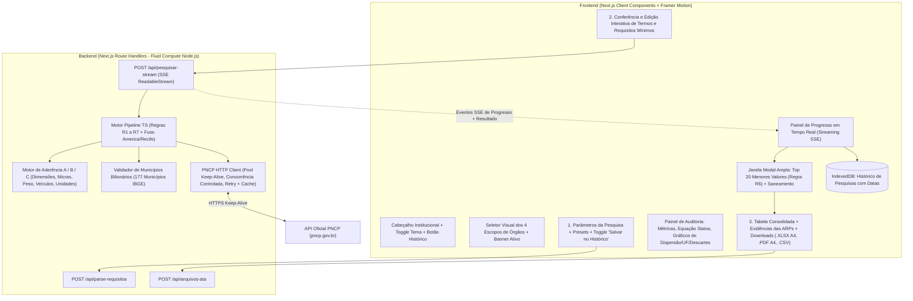

# Documento de Design (Spec): Sistema de Pesquisa de Preços em Atas do PNCP — Edição Web Vercel

**Data:** 2026-10-31  
**Autor Original / Domínio:** Sérgio Dantas Torres (Gestor Governamental de Controle Interno — CGM Recife)  
**Plataforma Alvo:** Vercel (Next.js App Router Full-Stack em TypeScript + Node.js 24 LTS / Fluid Compute)

---

## 1. Intenção e Propósito ("Why")

Transformar o sistema local em Python/Streamlit de **Pesquisa de Preços em Atas de Registro de Preços (PNCP)** em uma aplicação web moderna, de altíssima performance, pronta para produção na **Vercel**, com design sofisticado, efeitos visuais elegantes, animações fluidas e recursos avançados de análise estatística, auditoria e exportação documental (Excel A4, PDF executivo, CSV e Histórico persistente), mantendo **100% de fidelidade e paridade** com todas as regras de negócio e auditoria originais (Lei nº 14.133/2021 e IN SEGES/ME nº 65/2021).

---

## 2. Objetivos, Não-Objetivos e Anti-Objetivos

### 2.1. Objetivos (Goals)
1. **Paridade Absoluta com o Motor de Auditoria Original:**
   - Preservar integralmente as Regras **R1** (Critério de validade de órgãos: União, Estados, DF e os 177 municípios bilionários de `municipios_bilionarios_2026.csv`), **R2** (Casamento estrito de municípios por código IBGE de 7 dígitos e/ou igualdade exata de `nome_normalizado + UF`, proibido substring), **R4** (Tratamento de atas canceladas e divergência de status local vs. API como revisão manual `B`), **R5** (Preço unitário homologado > 0 vindo exclusivamente de `/resultados` e compatibilidade estrita de unidade de fornecimento sem conversão artificial), **R6** (Máximo de 1 item por ata na seleção final para não distorcer a média, mais deduplicação por `(CNPJ, nº ata, nº item)` e `(CNPJ, ano_compra, seq_compra, nº item)`) e **R7** (Descarte de esfera não identificada no escopo de validade).
   - Preservar os **4 Escopos de Órgãos** (expondo todos os 4 claramente na interface principal):
     1. **Critério de validade** (União, Estados, DF e Municípios com orçamento $\ge$ R$ 1 bilhão).
     2. **Todos os órgãos do Brasil** (Federal, Estadual, Distrital e Municipal sem restrição de lista, mas registrando na memória se atende ao critério de validade).
     3. **ARPs por Estado (UF)** (Filtra nativamente por qualquer uma das 27 UFs escolhidas pelo auditor: Estado + Municípios daquela UF).
     4. **Governo de Pernambuco e Prefeitura do Recife** (Poder Executivo Estadual de PE e Executivo Municipal do Recife, descartando Legislativo/Judiciário/TCE/MPPE — ideal para objetos com dedicação exclusiva de mão de obra / CCT local).
   - Preservar os **3 Status da Ata** (`Vigentes`, `Não vigentes`, `Todos`) e a **Conferência Automática da Equação na API** (`Todos == Vigentes + Não vigentes`) para cada termo buscado.
   - Preservar os **3 Tipos de Data no Período** (`Data de assinatura da ata`, `Data de publicação no PNCP`, `Vigência` com interseção de pelo menos 1 dia no período), validados no calendário `America/Recife` (UTC-3).
   - Preservar o **Extrator Inteligente de Termos de Busca e Requisitos Mínimos** ([parser_requisitos.py](file:///g:/Meu%20Drive/Projetos%20Antigravity/Pesquisa%20de%20Pre%C3%A7os%20PNCP/src/parser_requisitos.py)) e o classificador de aderência (`A`, `B`, `C`), com etapa interativa de edição/adição/remoção de termos e requisitos antes de disparar a varredura.
   - Preservar a **Janela Modal dos 20 Menores Valores Unitários** (com abertura automática após a busca, toggle para incluir itens `B`, botões de seleção rápida, filtro complementar e rodapé ao vivo com a média e estatísticas).
   - Preservar a **Exportação Excel Formatada para Folha A4 (`.xlsx`)** com 3 abas (`Planilha_Parecer`, `Memoria_de_Pesquisa`, `Descartados`), fonte Arial, configuração de página A4 retrato (`fitToWidth = 1`), fórmula nativa `=AVERAGE(B2:B{N})` na linha de média e quadro complementar de links diretos das ARPs e PDFs.

2. **Novas Funcionalidades Adicionadas (Aprovadas pelo Usuário):**
   - **Histórico Salvo de Pesquisas (com Controle de Gravação):**
     - Chave seletora (Switch/Toggle) na barra de busca: *"Salvar esta pesquisa automaticamente no Histórico"* (ativada por padrão, podendo ser desativada pelo usuário a qualquer momento, além de botão manual *"Salvar no Histórico"*).
     - Armazenamento persistente no navegador via **IndexedDB** (suporta milhares de atas/itens sem o limite de 5 MB do `localStorage`), guardando data/hora exata da pesquisa (`DD/MM/AAAA HH:MM:SS`), objeto pesquisado, filtros aplicados, requisitos, métricas, itens candidatos, itens selecionados e descartados.
     - Gaveta/Painel de **Histórico de Pesquisas**: permite filtrar histórico por data ou texto, **restaurar instantaneamente** qualquer pesquisa anterior na tela (sem precisar consultar o PNCP novamente), comparar pesquisas, excluir registros individuais, limpar histórico ou exportar/importar backup `.json`.
   - **Painel Visual de Estatísticas e Gráficos Interativos (Dispersão e Distribuição):**
     - **Gráfico de Dispersão de Preços (Scatter / Strip Plot Interativo):** Plota os itens encontrados (eixo X = Data de Assinatura ou Índice da Ata; eixo Y = Valor Unitário em R$), destacando visualmente os itens selecionados pelo auditor, a linha de **Média**, a **Mediana** e a faixa de desvio-padrão / intervalo interquartil (IQR), com tooltip completo ao passar o mouse.
     - **Gráfico de Distribuição por UF e por Esfera Administrativa:** Visualização rápida da origem geográfica e institucional das atas encontradas.
     - **Gráfico de Funil de Auditoria e Motivos de Descarte:** Mostra visualmente a transparência do filtro (Atas brutas $\rightarrow$ Atas no Escopo/Período $\rightarrow$ Itens Avaliados $\rightarrow$ Aderência A/B vs. Motivos de Descarte).
   - **Geração de Relatório Executivo em PDF (A4 para Parecer Técnico / Controle Interno):**
     - Além do `.xlsx` e do `.csv`, botão para baixar/imprimir **Relatório Técnico de Pesquisa de Preços em PDF (A4)**, diagramado com cabeçalho institucional sóbrio, metadados de auditoria (data/hora da consulta, escopo, equação de status do PNCP, requisitos mínimos), quadro estatístico (Média, Mediana, Menor Preço, Maior Preço, Coeficiente de Variação), Tabela Consolidada com a Média, e Quadro de Evidências com links clicáveis para a página da ata no PNCP e download direto do PDF original da ARP.
   - **Filtros Complementares e Detecção de Outliers (Saneamento Estatístico Opcional):**
     - Na janela de seleção dos 20 menores valores e na tela principal, adicionar filtros rápidos em tempo real (filtrar por palavra-chave na descrição/fornecedor, filtrar por Esfera, filtrar por UF, faixa de preço mín/máx) e **Assistente de Saneamento Estatístico** (botão opcional *"Sugerir exclusão de outliers / preços inexequíveis ou excessivos"* baseado na Mediana $\pm$ Desvio/IQR, conforme boas práticas da IN SEGES nº 65/2021, mantendo controle 100% manual nas mãos do auditor).
   - **Catálogo de Exemplos Rápidos (Presets de Teste):**
     - Botões de preenchimento rápido (ex.: *"Lona Plástica Preta 8x100m 200 micras"*, *"Locação de Veículo Hatch 1.0 sem motorista"*, *"Ar-Condicionado Split Inverter 12.000 BTUs"*, *"Café Torrado e Moído 500g"*) para testar ou demonstrar o sistema com 1 clique.

3. **Design Moderno, Bonito e com Efeitos Visuais Elegantes:**
   - Identidade visual **Executive GovTech / LegalTech**: preserva as cores de autoridade do sistema original — **Azul-Marinho Profundo (`#1B365D` / `#0F2342`)** e **Ouro/Latão (`#B59410` / `#D4AF37`)** — combinadas com superfícies em **Glassmorphism sutil**, bordas luminosas discretas, gradientes institucionais refinados, suporte completo a **Modo Claro e Modo Escuro (Light / Dark Mode)**, micro-interações com **Framer Motion**, skeletons animados e barra de progresso em tempo real via streaming SSE.
   - Tipografia moderna: **Plus Jakarta Sans** / **IBM Plex Sans** para interface e **JetBrains Mono** para números, preços, CNPJs, códigos IBGE e fórmulas.

### 2.2. Não-Objetivos (Non-Goals)
- Não exigir login/autenticação obrigatória para usar o sistema (acesso imediato como ferramenta de trabalho ágil, tal qual o sistema original).
- Não substituir a fonte de dados: toda busca de preços continua vindo **exclusivamente** da API oficial do PNCP (`https://pncp.gov.br/api/`).

### 2.3. Anti-Objetivos (Anti-Goals — O que configuraria falha)
- Nunca estimar ou inventar preços ou quantitativos ausentes na API.
- Nunca usar `valorUnitarioEstimado` da fase interna como preço válido da ARP (usar exclusivamente `valorUnitarioHomologado > 0` do endpoint `/resultados`).
- Nunca violar a Regra R6 (jamais permitir 2 itens da mesma ata na janela dos 20 menores valores).
- Nunca produzir um arquivo `.xlsx` sem a fórmula `=AVERAGE(...)` ou sem as 3 abas canônicas (`Planilha_Parecer`, `Memoria_de_Pesquisa`, `Descartados`).

---

## 3. Restrições Técnicas e Ambiente Vercel

1. **Runtime Vercel:** Node.js 24 LTS com **Fluid Compute** (suporta até 300s de execução e reutilização de instância/conexões HTTP keep-alive entre requisições concorrentes). Não usar `export const runtime = 'edge'`.
2. **Configuração de Projeto:** Arquivo `vercel.ts` (ou `next.config.mjs` compatível) seguindo o padrão atualizado da Vercel.
3. **Dados Embarcados:** O arquivo [municipios_bilionarios_2026.csv](file:///g:/Meu%20Drive/Projetos%20Antigravity/Pesquisa%20de%20Pre%C3%A7os%20PNCP/municipios_bilionarios_2026.csv) (177 municípios com código IBGE validado) e o cache IBGE ([ibge_municipios_cache.json](file:///g:/Meu%20Drive/Projetos%20Antigravity/Pesquisa%20de%20Pre%C3%A7os%20PNCP/.cache_pncp/ibge_municipios_cache.json)) serão empacotados estaticamente em JSON/TypeScript dentro de `src/data/` para leitura em `0ms` na Vercel sem depender de escrita em disco nem de chamada externa lenta ao IBGE a cada cold start (mantendo fallback para a API do IBGE caso necessário).
4. **Cache de Requisições PNCP na Vercel:**
   - Cache em memória de módulo (`Map` global com TTL e LRU na instância Fluid Compute) combinado com a API `fetch` cache/Next.js Cache para evitar consultar repetidamente a mesma ata/compra/item durante a sessão.

---

## 4. Abordagens Consideradas e Decisão

1. **Opção 1 (Escolhida pelo Usuário): Next.js App Router Full-Stack (TypeScript) + Tailwind CSS + shadcn/ui + Framer Motion + Recharts + ExcelJS**
   - *Por que venceu:* Arquitetura unificada na Vercel, streaming nativo via `ReadableStream` (Server-Sent Events) para exibir o progresso real da abertura de dezenas de atas sem travar a UI, geração client/server de `.xlsx` A4 idêntico ao `openpyxl` via `ExcelJS`, gráficos científicos com `Recharts` e persistência rica no navegador com `IndexedDB`.
2. **Opção 2 (Descartada): Híbrido Next.js + Python Serverless**
   - *Motivo do descarte:* Duplicação de runtimes e cold start mais pesado.
3. **Opção 3 (Descartada): SPA Estática Pura**
   - *Motivo do descarte:* Limitações de CORS e ausência de pool de conexões keep-alive no servidor.

---

## 5. Arquitetura Detalhada da Aplicação (`Pesquisa de Preços PNCP Vercel`)

### 5.1. Estrutura de Diretórios
- `src/data/`
  - `municipios-bilionarios.json` (convertido de `municipios_bilionarios_2026.csv` com todos os 177 municípios e `codigo_ibge` validados).
  - `ufs-brasil.ts` (as 27 Unidades da Federação e constantes do domínio).
- `src/lib/domain/`
  - `types.ts`: Interfaces estritas (`RequisitoMinimo`, `ItemCandidato`, `RegistroDescartado`, `ConferenciaStatusApi`, `ResultadoPesquisa`, `RegistroHistoricoPesquisa`, etc.).
  - `tz-recife.ts`: Utilitários de data no calendário `America/Recife` (`parseDataCalendarioRecife`, `formatarDataBr`, `verificarPeriodoLocal`, `verificarStatusLocal`).
  - `municipios.ts`: `ValidadorMunicipios` implementando Regras R1, R2 (igualdade exata sem acentos ou código IBGE, sem substring) e R7, além de `verificarEscopoEspecialOrgao` para `ESCOPO_POR_ESTADO` e `ESCOPO_PE_RECIFE`.
  - `parser-requisitos.ts`: Port completo de `gerarTermosBusca`, `extrairRequisitosMinimos`, `extrairDimensoesItem`, `extrairEspessuraMicrasItem`, `extrairPesoKgItem`, `verificarUnidadeCompativel` e `avaliarAderenciaItem` (`A`, `B`, `C`).
  - `pncp-client.ts`: Cliente assíncrono com pool de conexões (`undici` / `fetch` keep-alive), limite de concorrência (`p-limit` / pool de 10 workers), retry com backoff exponencial, cache em memória e métodos para `/api/search/`, `/atas/{seq}`, `/compras/{seq}`, `/itens`, `/resultados` e `/arquivos`.
  - `pipeline.ts`: `executarPipelinePesquisa` e `selecionarTop20Menores` com emissão de eventos de progresso para o stream SSE e implementação rigorosa da Regra R6.
- `src/lib/export/`
  - `exporter-xlsx.ts`: Geração do arquivo `.xlsx` usando `exceljs`, replicando fielmente as 3 abas (`Planilha_Parecer`, `Memoria_de_Pesquisa`, `Descartados`), fonte Arial, cores `#1B365D` / `#B59410` / `#F4EFE0`, configuração de página A4 retrato (`fitToPage`, `fitToWidth = 1`), cálculo de altura dinâmica de linha, fórmula `=AVERAGE(B2:B{N})`, rodapé com crédito ao autor e hiperlinks clicáveis.
  - `exporter-csv.ts`: Geração do `.csv` com BOM UTF-8 (`\uFEFF`) e separador `;`.
  - `exporter-pdf.ts`: Geração de Relatório Técnico A4 em PDF (usando janela de impressão estilizada de alta precisão e/ou geração direta em PDF com `jspdf` + `jspdf-autotable`) pronto para anexação em Processo Administrativo / Parecer Técnico.
- `src/lib/storage/`
  - `history-db.ts`: Camada IndexedDB para salvar, listar, buscar, restaurar, excluir e exportar/importar o histórico de pesquisas, respeitando a flag *"Salvar no histórico"*.
- `src/app/api/`
  - `parse-requisitos/route.ts`: Endpoint instantâneo para extrair termos e requisitos mínimos da descrição.
  - `pesquisar/route.ts`: Endpoint streaming (`text/event-stream` - SSE) que executa o pipeline no servidor da Vercel e envia progresso detalhado em tempo real até entregar o payload consolidado.
  - `arquivos-ata/route.ts`: Endpoint para enriquecer itens com os links diretos dos arquivos/PDFs oficiais das ARPs (`/arquivos`).
- `src/components/`
  - Componentes modulares com design moderno, animações `framer-motion`, gráficos `recharts` (dispersão de preços, distribuição por UF/esfera, motivos de descarte), janela modal interativa dos 20 menores valores, painel de histórico e cartões de evidências.

---

## 6. Decisões Deixadas para o Construtor (Builder Calls)
- Escolha dos pacotes utilitários de UI (`lucide-react`, `framer-motion`, `recharts`, `exceljs`, `jspdf`, `jspdf-autotable`, `clsx`, `tailwind-merge`).
- Organização interna dos subcomponentes visuais e animações de transição.
- Criação de suíte de testes automatizados (`vitest`) validando as regras R1–R7, parser de requisitos, fuso `America/Recife` e geração da planilha Excel com `=AVERAGE(...)`.
